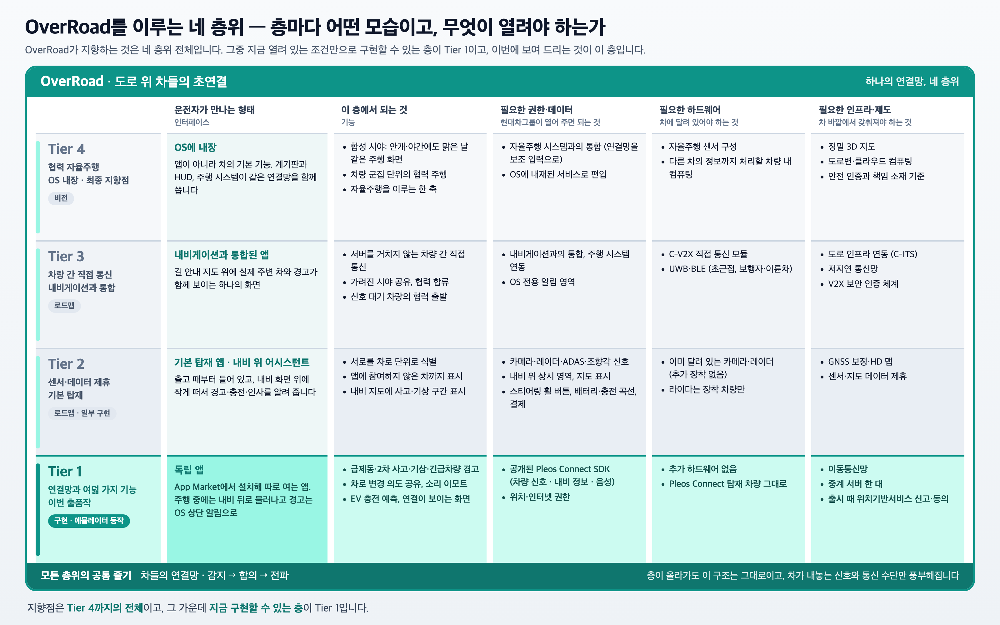
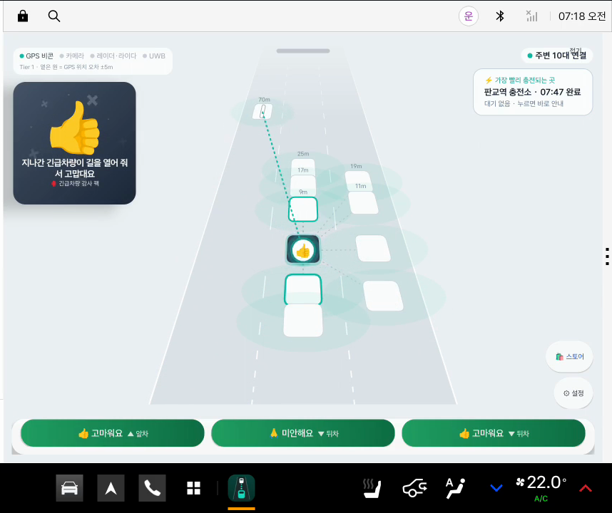

# OverRoad (오버로드)

> 도로 위(Over the Road)에서 모든 차를 내려다보며 잇는 차량 간 연결망

현대자동차그룹 차량용 앱 개발 공모전 출품작입니다. Pleos Connect SDK로 만든 차량 앱과 중계 서버로 이루어져 있습니다.

OverRoad는 현대차그룹의 압도적인 국내 점유율을 기반으로 도로 위 차들을 하나로 잇는 **차량 간 통신·초연결 아키텍처**입니다. 지금까지 차는 저마다 혼자 보고 혼자 판단하는 개체였지만, OverRoad는 초연결을 통해 도로 위의 차들을 벌이나 개미의 군락처럼 하나의 군집으로 봅니다. 이 경험은 앞으로의 모빌리티가 누구에게나 제공해야 할 보편적인 기능이라고 봅니다. 그래서 따로 실행하는 독립 앱에 머무르지 않고, 구현 수준에 따라 다른 앱·주행 시스템과의 협력 → 주행 시스템과의 완전한 통합 → OS에 내재된 기능으로 확장되어, 궁극적으로 자율주행을 이루는 한 축으로 동작하는 것을 지향합니다. 이 지향점까지를 Tier 1부터 Tier 4까지 네 층위로 구상하고 있고, 그 가운데 지금 구현할 수 있는 층이 Tier 1이어서 이 저장소는 Tier 1을 담고 있습니다. 급제동 경고나 충전 예측 같은 기능은 이 연결에서 파생되는 결과입니다.

이 저장소는 그중 **Tier 1**입니다. 지금 쓸 수 있는 Pleos Connect SDK의 차량 신호와 이동통신만으로 연결망(줄기)을 세우고, 거기서 뻗은 여덟 가지 기능(가지)을 에뮬레이터에서 동작하게 만들었습니다. 같은 줄기가 Tier 2~4(센서 공유, 차량 간 직접 통신, 협력 자율주행)에도 그대로 쓰이며, 층이 더해질수록 가지가 늘어납니다. 운전자가 만나는 형태도 독립 앱(Tier 1)에서 기본 탑재 앱·내비 위 어시스턴트(Tier 2), 내비게이션과 통합된 앱(Tier 3), OS 내장(Tier 4)으로 바뀝니다.



## Tier 1의 가지: 같은 연결망에서 뻗은 기능

모든 기능은 "감지 → 합의 → 전파" 한 줄기를 지나갑니다. 무엇을 감지하고 누구에게 전할지만 다릅니다.

| 기능 | 내용 |
|---|---|
| 급제동 경고 | 감속도와 브레이크 입력으로 급제동을 판정하고, 같은 방향으로 10초 안에 닿을 뒤차에만 경고(차로 단위 선별은 에뮬레이터 시연, 실차는 Tier 2부터). 브레이크부터 뒤차 화면까지 평균 0.64초(실측) |
| 2차 사고 방지 | 에어백·비상등·도로 위 정차로 사고·정차 차량을 판단하고, 사고 정체가 생기면 정체 꼬리에서 한 번 더 경고 |
| 기상·노면 위험 | 와이퍼·안개등·ABS·ESC 경고등이 한 지역에서 동시에 많이 켜질 때 확정, 외부 제공 피드(JSON·GeoJSON) |
| EV 충전 예측 | 충전소의 지금 상태와 오는 차량으로 내 순번·대기·완료 시각 예측, 충전 기록과 별점 축적. 충전이 가장 빨리 끝나는 근처 충전소를 늘 계산해 두고, 버튼 한 번으로 그곳까지 안내 |
| 긴급차량 길 터주기 | 구급·소방·경찰차 접근을 앞쪽 1km 차량에 남은 거리와 방향 안내(시연에서는 차로까지) |
| 차로 변경 의도 공유 | 깜빡이를 켜면 옆 차로에서 다가오는 차에만 알림, 진입 성공 시 자동 감사 인사(차로 값이 필요해 시연 기준, 실차는 Tier 2) |
| 소리 이모트 | 비상등 인사를 대신하는 👍·🙏·👋. 받을 바로 앞차·뒤차는 청록 테두리로 표시되고, 보내면 그 차와 이어진 점선을 따라 이모티콘이 날아간다. 5초 2번·같은 차 3분 제한(버튼이 왼쪽부터 차오름), "항상 감정표현 받지 않기" |
| OverRoad 기본 화면 | 참여 차량이 초당 5번 보내는 실제 위치·상태로 그린 주변 차량 인식 화면. 경고와 이모트는 보낸 차와 내 차를 잇는 선을 따라 오간다. 참여 차 센서가 본 비연동 차량 표시 경로(Tier 2) |



운전 중 주의 분산을 먼저 고려했습니다. 주행 중에는 내비가 앞에 있고, 경고는 OS 상단 알림과 같은 흰 카드와 음성으로만 전합니다. 한 번 누르면 끝나는 이모트 보내기는 비상등 스위치처럼 주행 중에도 되고, 설정·스토어처럼 여러 단계를 거치는 조작은 정지 중에만 됩니다.

## 저장소 구성

```
app/       차량 앱 (Kotlin, Pleos Connect SDK: Vehicle · NaviHelper · TextToSpeech)
server/    중계 서버 (Python 표준 라이브러리만 사용) + 실시간 대시보드
scripts/   가상 차량 시뮬레이터(fleet.py), 기능별 시연 시나리오, 지연시간 측정, 녹화 도구
docs/      통합보고서(PDF), 지향점·Tier별 기능, 기술 리포트(판별 로직), 개선 기록, 지연시간 실측
apk/       release APK
```

자세한 설명은 [`docs/OverRoad_통합보고서_상세판.pdf`](docs/OverRoad_통합보고서_상세판.pdf)에 있습니다. 판별 로직은 [`docs/technical_report.md`](docs/technical_report.md), Tier별 로드맵은 [`docs/philosophy.md`](docs/philosophy.md)를 보세요.

## APK

- 위치: [`apk/OverRoad_OverRoad_release.apk`](apk/OverRoad_OverRoad_release.apk) (release 빌드, 서명됨)
- 패키지: `com.hyperconnect.app` · 버전 0.1.0 · minSdk 28 · targetSdk 34

## 테스트 환경 및 필요한 설정

| 항목 | 내용 |
|---|---|
| 에뮬레이터 | Pleos Connect Emulator v2.1.0 (Android 14, API 34), 시연은 2대(B·C) 동시 실행 |
| 개발 도구 | Android Studio (내장 JDK 사용), Gradle Wrapper 포함, Kotlin |
| Pleos SDK | Vehicle 2.3.2 · NaviHelper 3.0.5 · TextToSpeech 3.3.1 |
| 서버 | Python 3 (추가 패키지 없음), 호스트 PC의 8080 포트 |
| 권한 | `android.car.permission.CAR_SPEED`(속도), `POST_NOTIFICATIONS`(경고 알림) — 아래 실행 방법의 `pm grant`로 허용 |
| 첫 실행 | 데이터 공유 동의 화면에서 동의해야 서버 연결을 시작합니다(`--ez consent true`로 건너뛸 수 있음) |
| 확인한 성능 | 주행 중 CPU 약 3%(한 코어 기준, 위치를 초당 5번 보낼 때), 메모리 약 65MB (Pleos 기준 5% 미만 · 400MB 이하) |

## 실행 방법

필요한 것: Android Studio(JDK 포함), Pleos Connect Emulator(Android 14, API 34), Python 3.

```bash
# 1) 중계 서버 (대시보드: http://127.0.0.1:8080/dashboard)
python3 -I server/server.py

# 2) 에뮬레이터를 켠 뒤 앱 설치 (release APK 또는 직접 빌드)
adb install -r apk/OverRoad_OverRoad_release.apk
# 직접 빌드할 때는 Android Studio의 JDK를 쓴다
JAVA_HOME="/Applications/Android Studio.app/Contents/jbr/Contents/Home" ./gradlew :app:assembleDebug

# 3) 차량 속도 권한과 알림 권한
adb shell pm grant --user 10 com.hyperconnect.app android.car.permission.CAR_SPEED
adb shell pm grant --user 10 com.hyperconnect.app android.permission.POST_NOTIFICATIONS

# 4) 실행 (vehicle_id: 서버에서 쓰는 가명 ID, lane: 차로 번호)
adb shell am start -n com.hyperconnect.app/.MainActivity --es vehicle_id B --ei lane 2
```

앱은 에뮬레이터 안에서 `http://10.0.2.2:8080`(호스트 PC의 서버)에 접속합니다. 다른 서버를 쓰려면 실행할 때 `--es server http://주소:포트`를 붙입니다.

에뮬레이터 2대와 가상 차량으로 여러 대의 도로 상황을 만들 수 있습니다.

```bash
bash scripts/scenarios/launch_bc.sh                              # 에뮬레이터 B, C 실행
python3 scripts/fleet.py run --anchor B A:2:+250 D:1:-120       # 가상 차량 추가
bash scripts/hard_brake.sh                                       # B 급제동
```

기능별 시연 시나리오는 `scripts/scenarios/scenario_*.sh`에 있습니다. 각 파일 머리말에 무엇을 보여 주는지 적어 두었습니다.

### 시나리오 스크립트를 돌리려면

시나리오 스크립트는 개발에 쓴 환경(macOS)을 그대로 가정합니다. 아래가 맞아야 동작합니다.

| 전제 | 내용 |
|---|---|
| 서버 로그 파일 | 스크립트가 서버 로그를 읽어 결과를 확인합니다. 서버를 `python3 -I server/server.py > server.log 2>&1 &`로 띄우고, 로그 파일을 첫 인자로 줍니다. 예: `bash scripts/scenarios/scenario_lane.sh server.log` (`scenario_surround*.sh`, `scenario_store.sh`는 인자 없음) |
| adb 위치 | `~/Library/Android/sdk/platform-tools/adb` |
| 에뮬레이터 | 2대, 시리얼 `emulator-5554`(B) · `emulator-5556`(C). 각각 `-port 5554`, `-port 5556`으로 켭니다 |
| Virtual Console | `adb -s emulator-5554 forward tcp:8088 tcp:8088`, `adb -s emulator-5556 forward tcp:8089 tcp:8088` (차량 속도·기어·방향지시등 조작용) |
| 앱 | `launch_bc.sh`가 설치합니다. 직접 빌드한 디버그 APK가 있으면 그것을, 없으면 `apk/OverRoad_OverRoad_release.apk`를 씁니다. 서명이 다른 앱이 이미 있으면 먼저 지워야 합니다 |
| 기준 위치 | 에뮬레이터 내비의 기본 위치(위도 37.4127 부근)를 기준으로 가상 차량을 놓습니다 |

시나리오 사이에는 `bash scripts/scenarios/stop_fleet.sh`로 가상 차량을 정리합니다.

## 지연시간 실측 (급제동 경고, 에뮬레이터 10회)

| 구간 | 평균 | 최대 |
|---|---|---|
| 브레이크 → 급제동 판정 | 631 ms | 755 ms |
| 판정 → 서버 → 뒤차 화면 | 6 ms | 7 ms |
| 전체 | 637 ms | 761 ms |

같은 PC 안에서 잰 값이라, 실제 이동통신망에서는 전달 구간에 수십~수백 ms가 더해질 수 있습니다. 자세한 내용은 [`docs/latency.md`](docs/latency.md)에 있습니다.

## 프로토타입의 한계

출품작은 에뮬레이터에서 동작을 보이는 프로토타입입니다. 아래는 알고 남겨 둔 부분이며, 출시 전에 해결할 과제입니다.

- **인증·암호화 없음**: 차량 ID는 가명 문자열이고 서버는 보낸 쪽을 인증하지 않습니다. 통신은 HTTP 평문입니다. 출시 때는 차량 인증과 HTTPS, 긴급차량 역할의 기관 인증이 필요합니다.
- **시연용 실행 인자**: `--ez consent true`(동의 화면 건너뛰기), `--es server`(서버 주소), `--es vehicle_id`·`--ei lane`·`--ed offset_m`(차량 ID·차로·위치)은 시연과 검증을 위한 것으로, 상용 빌드에서는 제거합니다.
- **위치**: 에뮬레이터의 내비 위치는 움직이지 않아, 내비 기준점에 속도를 적분해 위치를 만듭니다(추측항법).
- **서버**: 메모리에만 상태를 두는 단일 프로세스입니다. 재시작하면 충전 기록·통계가 초기화됩니다.
- **주행 중 기본 화면 유지**: 설정의 "주행 중에도 연결망 화면 유지"는 상위 Tier(합성 시야)를 미리 보여 주는 선택 옵션이며, 기본값은 꺼짐입니다(주행을 시작하면 내비가 앞에 옵니다).

## 참고

- 패키지 이름 `com.hyperconnect.app`은 개발 중 가제(HyperConnect)의 흔적입니다. 앱 표시 이름은 OverRoad입니다.
- 차로 번호는 시연용 입력값입니다. 실차 Tier 1은 일반 GPS를 쓰므로 차로 단위 식별은 Tier 2(센서 공유) 이후의 과제입니다.
- 이모트 소리는 모두 직접 합성했습니다(`scripts/make_emote_sounds.py`). 게임이나 다른 작품의 소리·그림은 쓰지 않았습니다.
