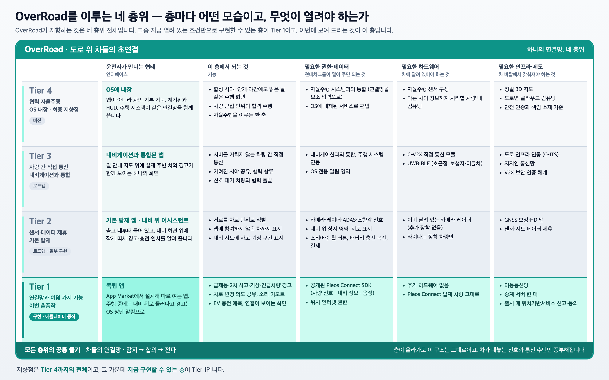
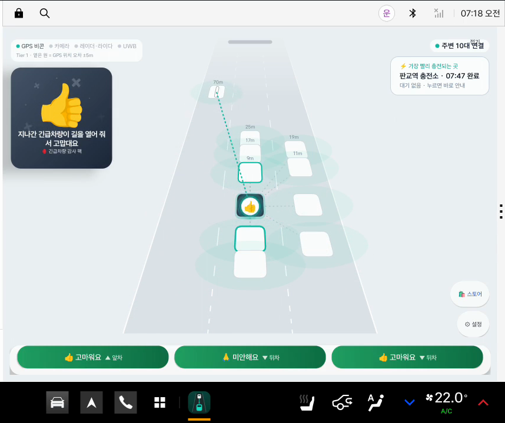

## OverRoad 소개
OverRoad는 현대차그룹의 압도적인 국내 점유율을 기반으로 도로 위 차들을 하나로 잇는 **차량 간 통신·초연결 아키텍처**다. 이 연결망 위에서 운전자는 내 눈과 센서가 닿지 않는 곳의 급제동·사고·악천후를 먼저 본 차에게서 미리 전해 듣고, 충전소 대기를 도착 전에 알며, 주변 차와 인사를 주고받는다.

지금까지 차는 저마다 혼자 보고 혼자 판단하는 개체였지만, OverRoad는 초연결을 통해 도로 위의 차들을 벌이나 개미의 군락처럼 하나의 군집으로 본다. 이 경험은 앞으로의 모빌리티가 누구에게나 제공해야 할 보편적인 기능이다. 그래서 따로 실행하는 독립적인 앱에 머무르지 않고, 다른 앱·주행 시스템과의 긴밀한 협력에서 주행 시스템과의 완전한 통합으로, 나아가 OS 수준에 내재된 모빌리티의 본질적인 기능으로 확장되어, 궁극적으로 자율주행을 이루는 한 축이 되는 것을 지향한다. 그때 주행의 주체는 차 한 대에서 차량 군집으로 넓어진다. 1초 안의 경고 같은 기능은 본질이 아니라 이 연결에서 파생되는 결과다.

이 지향점까지를 접근할 수 있는 기술 수준에 따라 Tier 1부터 Tier 4까지 네 층위로 구상했고, 그 가운데 지금의 Pleos Connect SDK만으로 구현할 수 있는 것이 Tier 1(연결망과 그 위에서 뻗어 나온 여덟 가지 기능)이다. 이번 출품작은 기능을 모은 앱 하나라기보다, 이 아키텍처를 제안하고 그것이 지금의 SDK만으로 동작함을 보이는 첫 구현에 가깝다. 그리고 이것을 운전자가 골라 설치하는 앱이 아니라, 모든 운전자가 기본으로 누리는 **보편적인 모빌리티 경험**으로 만들고자 한다.

**줄기는 도로 위 차들의 초연결이고, 기능은 거기서 뻗은 가지다.** Tier 1~4는 모두 하나의 OverRoad를 이루는 층위이고, 이번 출품작은 그중 지금 구현할 수 있는 Tier 1이다 — 지금 쓸 수 있는 차량 신호와 이동통신만으로 세운 줄기와, 거기서 뻗은 여덟 개의 가지. 같은 줄기가 Tier 2~4에도 그대로 쓰이며, 층이 더해질수록 가지가 늘어난다.

## 최종 비전: 개체에서 군집으로 — 군집 단위의 통합 자율주행
OverRoad가 최종적으로 겨냥하는 것은 차 한 대의 자율주행이 아니라, **군집으로 확장된 자율주행**이다. OverRoad라는 연결망이 존재하는 이유가 여기에 있다.

- **개체는 그대로 완전해야 한다.** 각 차는 자기 센서와 자기 판단만으로 온전히 주행할 수 있어야 한다. 이것은 전제이고, 군집은 이를 대신하지 않는다.
- **군집은 그 위에 시너지를 더한다.** 연결된 차들이 하나의 스웜(swarm)을 이루면, 개체로는 얻을 수 없는 능력이 생긴다.
  - 인지의 확장: 한 대의 센서가 닿지 않는 곳(가려진 차, 커브 너머, 안개 속)을 다른 차의 눈으로 본다. 앞차가 이미 본 것을 뒤차가 처음부터 다시 탐색하지 않는다.
  - 의도의 공유: 급제동, 차로 변경, 긴급 출동 같은 상대의 의도를 추측하지 않고 직접 전해 받는다.
  - 행동의 동기화: 신호가 바뀌면 한 대씩 차례로 출발하던 차들이 한 몸처럼 함께 출발하고, 합류할 때 간격을 함께 조정하며, 긴급차량 앞에서는 군집 전체가 길을 연다. (협력 출발은 Tier 3에서 출발 시점을 알려 주는 안내로 시작해, Tier 4에서 주행 제어로 완성된다.)
- 벌 한 마리, 개미 한 마리는 단순하지만 군락은 혼자서는 할 수 없는 일을 해낸다. 차도 같다. 주행의 주체가 차 한 대(개체)에서 차량 군집으로 넓어지는 것, 곧 **군집 단위의 통합 자율주행**이 최종 지향점이다.

OverRoad의 연결망(감지 → 합의 → 전파)은 이 군집의 신경계에 해당한다. Tier가 올라갈수록 같은 정보가 사람을 거치지 않고 주행 시스템으로 직접 들어간다.

| Tier | 군집 정보가 쓰이는 방식 |
|---|---|
| 1 (이번 출품작) | 사람에게 알린다. 다른 차가 본 위험과 의도를 경고·음성·소리로 운전자에게 전한다 |
| 2 | 누가 어느 차로에 있는지까지 안다. 센서와 신호를 짝지어 군집의 구성원을 차로 단위로 식별한다 |
| 3 | 차끼리 직접 주고받는다. 가려진 시야를 공유하고, 협력 합류와 협력 출발을 안내한다 |
| 4 | 주행 시스템이 직접 쓴다. 각 차의 자율주행 위에 군집 정보가 더해져, 군집 단위로 통합된 자율주행을 이룬다 |

그래서 Tier 1의 여덟 기능은 목적이 아니라, 군집 자율주행으로 가는 연결 아키텍처의 첫 층이 지금의 SDK만으로 동작함을 보인 것이다. 연결이 끊기면 언제든 개체로 돌아가 혼자서도 안전하게 달려야 한다는 원칙은 어느 Tier에서도 같다(4장).

## 1. 기능이 아니라 엔진
OverRoad의 본체는 개별 기능이 아니다. **점유율 기반 차량 간 연결망**이라는 엔진이다.

- 엔진: 차량 신호로 감지하고 → 여러 차량의 정보로 합의하고 → 그 위험을 실제로 만날 차량을 골라 전파한다.
- 기능: 급제동 경고, 2차 사고 방지, 기상, EV 충전, 긴급차량, 차로 변경, 감사 인사는 이 엔진 위에 탑다운으로 얹는 응용이다. 새 기능은 "무엇을 감지하고 누구에게 보낼지" 규칙만 더하면 된다.
- 그래서 비슷한 기능이 해외에 따로 있어도, 같은 엔진 하나로 모두를 묶어 제공한다는 점이 다르다.

## 2. 왜 현대차그룹인가: 점유율이 곧 성능
- 차량 간 경고는 참여 차량이 많을수록 효과가 커진다. 유럽 신차 안전 평가(Euro NCAP)도 폭스바겐 Car2X를 평가하며 장착 차량 수가 효과를 좌우한다고 보았다.
- 현대차그룹(현대·기아·제네시스)은 2025년 국내에서 125만 8,730대를 팔았다(현대차 71만 2,954대 — 제네시스 포함, 기아 54만 5,776대). 국산 완성차 5사 내수 판매(136만 6,344대)의 92.1%, 수입 승용차 신규 등록(30만 7,377대, 한국수입자동차협회)까지 더한 시장의 약 75%다. 자사 충전소·자사 망이 없어도, 공공 도로와 공공 충전망을 기본 탑재 이후에는 점유율만으로 덮을 수 있다(현대·기아는 상용 포함, 수입차는 승용 기준).
- 애플의 '나의 찾기'가 수억 대의 애플 기기로 잃어버린 물건을 찾듯, 많이 달리는 차량 그 자체가 인프라가 된다.

## 3. 앱에서 기본 기능으로
Tier가 올라갈수록 기능만이 아니라 운전자가 OverRoad를 만나는 형태(인터페이스)도 함께 바뀐다. Pleos가 나누는 앱 단계(사용자 설치 앱 → 기본 탑재 앱 → 시스템 앱)를 따른다.

| Tier | 제공 형태 (인터페이스) | 의미 |
|---|---|---|
| 1 | 독립 앱 (이번 출품작) | 운전자가 설치해 따로 여는 앱. 주행 중에는 내비 뒤로 물러나고 경고는 OS 상단 알림으로. 효과와 안전 설계를 증명 |
| 2 | 기본 탑재 앱 · 내비 위 어시스턴트 | 출고 차량 모두가 처음부터 참여 → 네트워크 밀도 확보. 내비 화면 위에 작게 떠서 경고·충전·인사를 알려 준다 |
| 3 | 내비게이션과 통합된 앱 | 길 안내와 주변 차량 인식이 하나의 화면. 경로 위에 실제 주변 차가 보이고 경고와 인사가 그 차에 붙는다 |
| 4 | OS에 내장 (시스템 서비스) | 경고음은 시스템 안전음으로, 감지는 플랫폼 수준에서, 자율주행 시스템과 통합. 그래도 위치 공유 동의·철회는 운전자의 권리로 남긴다 |

내비게이션은 OS에 기본 탑재된 순정 앱이다. 그래서 그 위에 뜨는 것(Tier 2)과 하나로 합치는 것(Tier 3)은 현대차그룹이 열어 줄 때 가능하다.

AI가 발전할수록 "앱"의 경계는 흐려진다. 남는 것은 차량들이 서로 연결된 네트워크와, 그 네트워크가 쌓는 도로의 실시간 지식이다.

## 4. 자율주행으로 가는 길: 내 센서는 온전히, 남의 정보는 추가 눈으로
- 군집은 개체의 판단을 대신하지 않고 그 위에 더해진다. 연결이 끊기면 언제든 개체로 돌아가 혼자서도 안전해야 한다(아래 원칙).
- **군집 인지의 비용**: 다른 차의 정보까지 함께 처리하면 연산량과 통신량이 크게 늘어난다. 차량 자체의 컴퓨팅 성능, 도로변·클라우드 컴퓨팅, 저지연 통신 인프라가 층위별로 갖춰져야 하며, 그 전까지는 서버가 필요한 정보만 골라 보내는 방식으로 차의 부담을 낮춘다.
- **초기 밀도에 대한 정직한 전제**: 점유율이 밀도가 되려면 기본 탑재가 필요하다. 설치형인 초기에는 앞뒤 차가 모두 참여해야 하는 급제동·차로 변경보다 충전 예측과 기상 구간, 공공 데이터 기본 레이어가 먼저 가치를 낸다.
- 최종 목표(Tier 4)는 시야가 전혀 없어도 주변 도로를 맑은 날처럼 보여 주는 **합성 시야(SVS)**. 서버의 차량 레지스트리는 Local Dynamic Map의 출발점이다.
- 위치 식별은 거리별 층위 L1 광역(비콘·GPS·V2X) → L2 중거리(카메라·레이더) → L3 근거리(라이다) → L4 초근접(UWB)로 쌓고, 누구인지 아는 신호와 정확한 위치를 아는 센서를 짝짓는다(3부 12-3).

- 지금 구현할 수 있는 형태가 Tier 1의 **OverRoad 기본 화면**(주변 차량 인식)이다: 모든 차가 이동통신 비콘으로 서로의 위치를 늘 알고 있고(군인의 IR 비콘처럼), 앱을 열면 어느 크기에서든 배경에 실제 주변 차를 그린다. 참여 차의 센서가 본 비연동 차까지 같은 화면에 올리는 경로도 만들어 두었다(센서 API가 열리면 바로). Tier 2에서 카메라·레이더, Tier 3에서 UWB 거리·방향을 더해 서로를 차로 단위로 식별하고, 정밀 3D 지도를 얹으면 SVS가 된다. 완성되면 내비 없이 OverRoad만 켜고 주행할 수 있다.
- **Tier 3의 목표는 내비게이션 시스템과의 통합, 궁극적인 목표(Tier 4)는 OS 내장과 자율주행 시스템과의 통합**이다. 길 안내 위에 실제 주변 차가 보이고, 경고와 이모트가 그 차에 바로 붙는 화면. 지금 둘을 나눈 것은 플랫폼 제약(오른쪽 화면에 앱 하나, 내비 지도에 그리는 API 없음) 때문에 **잠시 분리해 둔 것**이다.
- 원칙: 각 차량은 **자기 센서만으로 완전한 자율주행**을 한다. 다른 차량의 정보는 시야 밖을 보는 "추가 눈"으로만 쓴다. 네트워크가 끊겨도 안전해야 한다.
- 인지하는 과제: 같은 센서·소프트웨어를 쓰는 차량이 많을수록 같은 조건에서 동시에 같은 오류를 낼 수 있다(**공통 모드 고장**). 서로 다른 종류의 신호가 함께 가리킬 때 확정하고, 차종·소프트웨어 버전별 편향을 감시한다.

## 5. 안전이 먼저: 주의 분산을 만들지 않는다
- 내비를 가리지 않는다: 주행 중에는 내비가 앞에 있고, 경고는 화면 위쪽 알림과 소리·음성으로만. 경고는 어디서든 OS 상단 알림과 같은 흰 카드 한 가지 모양(아이콘과 초록 체크만 OverRoad)으로 — 궁극적으로 OS와 하나가 되기 위해. 내비가 앞이면 OS 알림(위치는 OS가 정함), OverRoad가 앞이면 같은 카드를 앱 상단 정중앙에. 주의·경고는 감정표현 설정과 상관없이 늘 뜬다. 조작은 두 가지로 나눈다: 한 번 누르면 끝나는 이모트 보내기는 비상등 스위치를 누르는 것과 같게 보고 주행 중에도 허용하고, 설정·스토어처럼 여러 단계를 거치는 조작은 정지 중에만(버튼 자체를 숨긴다). 위험한 순간(경고 중, 차로 변경 중)에는 받은 이모트를 미룬다.
- 차로 변경 직후처럼 운전 부하가 큰 순간의 감사 인사는 조작 없이 자동으로 보낸다.
- 출발 타이밍을 알려 주는 협력 출발처럼 사고를 부를 수 있는 기능은 저지연·검증 환경(Tier 3) 전까지 넣지 않는다.
- 안전 기능은 절대 유료화하지 않는다.

## 6. 사람 사이의 연결
- 비상등 인사를 대신하는 **소리 이모트**와 **자동 감사 인사**로, 말로 전할 수 없던 고마움과 미안함을 전한다. 받을 바로 앞차·뒤차는 청록 테두리로 보이고, 보내면 그 차와 이어진 점선을 따라 이모티콘이 날아간다.
- 소통이 공격이 되지 않게: 5초에 2번, 같은 차에는 3분에 한 번(그 차와 새 일이 생기면 다시 열림). **항상 감정표현 받지 않기**를 켜면 아무것도 받지 않고 대신 보낼 수도 없다 — 초보운전자는 경고만 받으며 쓸 수 있다.
- 이모트는 사운드 팩·IP 콜라보·크리에이터 마켓으로 이어지는 B2C 사업이 될 수 있다. 받는 쪽은 보낸 차의 팩 소리를 듣는다 — 도로 위에서 들어 본 소리가 곧 광고다. 유료 이모트도 주행 중에는 소리만 낸다.

## 7. 신뢰와 프라이버시
- 계정과 연결되지 않은 가명 ID, 위치는 실시간 판단에만(10초 갱신이 없으면 판단에서 제외). 동의해야 전송을 시작하고, 철회하면 서버 데이터를 지운다.
- 사용자별 신뢰 점수는 쓰지 않는다. 안전 경고는 보수적으로 일단 보내고, 조작된 보고는 차량 인증 같은 보안으로, 그 밖의 문제는 운영 피드백과 업데이트로 고친다.
- 내가 기여한 정보(경고, 충전 기록, 별점)는 다른 운전자를 돕고, 그 기여는 내 기여 화면과 배지로 돌아온다.

---

# Tier별 기능 구분

| Tier | 전제 | 기능 | 상태 |
|---|---|---|---|
| **1** | Pleos Connect SDK (지금 쓸 수 있는 차량 신호) + 이동통신 중계 서버 | 급제동 경고 (10초 안에 닿는 같은 방향 뒤차 — 차로 단위 선별은 시연, 브레이크등 아이콘) | 구현 |
| | | OverRoad 기본 화면 (주변 차량 인식, 모든 크기에서 앱 배경, 미니멀 사다리꼴 · 감속·깜빡이·긴급차량 줄 · GPS 오차, 주변 차 인지 표시(멀수록 흐려지는 회색 점선), 경고·이모트가 보낸 차와 잇는 선을 따라 오감, 바로 앞·뒤차 테두리, 주행 중 미리보기 옵션) | 구현 |
| | | 내 기여 화면 (내 보고 기록 · 받은 감사 · 배지) | 구현 |
| | | 2차 사고 방지 (사고·정차 차량 + 사고 정체 꼬리 경고, 옛 정체·사고 구간 통합) | 구현 |
| | | 기상·노면 위험 (지역 동시 다발 확정 · 외부 제공 피드) | 구현 |
| | | EV 충전 예측 · 충전 기록 · 별점 · 충전 여정 링·막대 | 구현 |
| | | 긴급차량 길 터주기 (경찰·소방·구급 역할별 표현) | 구현 |
| | | 차로 변경 의도 공유 (차로를 모르면 위치 기하로 넓게) · 자동 감사 인사 (진입 판정에 차로 값이 필요해 시연에서만, 실차는 Tier 2) | 구현 |
| | | 소리 이모트 · 데이터 공유 동의·철회, 남용 방지(5초 2번 · 같은 차 3분) · 항상 감정표현 받지 않기 | 구현 |
| | | 이모트 스토어 (기본·현대차 오리지널·특별 지급·창작마당, 정차 중에만), 긴급차량 감사 자동 전송 | 구현 (구매는 결제 SDK 후) |
| | | 내비를 가리지 않는 화면 (경고는 같은 흰 카드 + 음성: 내비 앞이면 OS 알림, 앱 앞이면 상단 정중앙 · 전체 화면은 정차 중에만) | 구현 |
| | | 음성 경고 (Pleos TTS 기기 내 모드) | 구현 |
| | | 음성 감사 인사 (Gleo 음성 비서 연동) | 가능 확인, Pleos 승인 필요 |
| **2** | 센서·ADAS·데이터 제휴 | 협력 측위 L1~L3: GPS 비콘 + GNSS 보정(RTK)·HD 맵 + 카메라·77GHz/4D 레이더 + 라이다(장착 차)로 서로를 차로 단위 식별 | 로드맵 |
| | | 내비 지도에 사고·기상 구간 직접 표시 (서버 외부 피드를 현대차 내비가 받아 표시) | 로드맵 (피드는 Tier 1에서 구현) |
| | | **기본 탑재 앱 · 내비 위 어시스턴트** (내비 화면 위에 작게 떠서 경고·충전 링·이모트 바를 상시 표시) | 로드맵 (컨셉 이미지) |
| | | 비연동 차량 표시 (참여 차 카메라·레이더가 본 차를 서버에 등록해 모두의 기본 화면에) | 서버·화면 구현, 센서 API 대기 |
| | | 포트홀·낙하물 감지, 미끄러운 노면 지도, HD맵 자동 갱신 | 로드맵 |
| | | 회전 깜빡이와 차로 변경 깜빡이 정밀 구분 (조향각·지도 차로 수) | 로드맵 (Tier 1용 1차 구분 방법은 설계만 해 둠, 미구현) |
| | | 차종별 배터리 용량·충전 곡선 (공공 충전기 API 실연동은 Tier 1 출시 과제) | 로드맵 |
| | | 스티어링 휠 버튼으로 감사 인사, 타사 차량·스마트폰 보조 참여 | 로드맵 |
| **3** | C-V2X·UWB·저지연 통신·공공 인프라 | L1 V2X 직접 통신(PC5 기본 안전 메시지), L4 UWB·BLE·Wi-Fi FTM(보행자·이륜차), 도로 인프라 I2V(C-ITS), 음향(사이렌 방향) | 로드맵 |
| | | **내비와 기본 화면 통합** (내비 지도 위에 주변 차량 층, 지금은 플랫폼 제약으로 분리) | 로드맵 |
| | | OS 전용 알림 영역 (지금은 OS가 상단 알림 위치를 정함) | 로드맵 |
| | | 끼어들기 동시 인지, 가려진 시야 공유 | 로드맵 |
| | | 협력 합류, 신호 대기열 협력 출발 (안전상 Tier 1에서 제외) | 로드맵 |
| | | 긴급차량 자동 양보 | 로드맵 |
| **4** | 협력 자율주행 | 가시광 통신으로 "눈앞의 저 차 = ID" 결합 (연구 단계) | 비전 |
| | | 합성 시야 (SVS): 연결망 + 내 센서 + 정밀 3D 지도로 안개·야간에도 맑은 날 같은 주행 화면, 내비 없이 OverRoad만으로 주행 | 비전 |
| | | **OS에 내장** (앱이 아니라 시스템 서비스, 자율주행 시스템과 통합) | 비전 |
| | | 자기 센서로 완전 자율 + 다른 차량 정보는 추가 눈 | 원칙 |
| | | 과제: 공통 모드 고장, 시공간 정렬, 채널 포화, 데이터 위조, 안전 인증·책임 | 인지 |

## 층위별 진입 조건

Tier 1~4는 서로 다른 제품이 아니라 하나의 OverRoad를 이루는 층위다. 모든 층위의 줄기(차들의 연결망, 감지 → 합의 → 전파)는 같고, 층마다 열려야 하는 조건이 다르다. 조건은 누가 풀 수 있는지에 따라 셋(현대차그룹이 열어 주는 권한·데이터, 차에 달린 하드웨어, 차 바깥의 인프라·제도)으로 나눴고, 맨 앞의 네 층위 그림에 층별로 정리했다.

Tier 2는 새 부품이 아니라 권한이 열리면 되는 층이라는 점이 중요하다. 차로를 예로 들면, Tier 1도 GPS 좌우 거리와 깜빡이 방향으로 '어느 쪽 옆에 대략 몇 m'까지는 알아서 넓게 알리고, Tier 2는 '몇 차로인지'를 확정해 해당 차에게만 정확히 알린다(3부 1-1 ⑥). Tier 1 → 2에서 막혀 있는 항목별 근거는 바로 아래 '기술적 제약으로 구현하지 못한 것'에 적었다. Tier 3·4의 조건은 방향만 적은 것이며 수치 기준은 아직 정하지 않았다. 형태를 그렇게 정한 이유는 2부 6번에 적었다.

---

# 기술적 제약으로 구현하지 못한 것

Tier 1은 "지금 공개된 Pleos Connect SDK와 에뮬레이터로 되는 것"까지다. 아래는 만들고 싶었지만 플랫폼·SDK 제약으로 만들지 못했거나, 다른 방법으로 대신한 것들이다. 제약의 근거는 Pleos 개발 문서, 에뮬레이터에서 직접 시험한 결과, 운영사무국 답변(2026-11-04~11-10)이다.

## 화면과 내비게이션

| 하고 싶었던 것 | 막은 제약 | 지금 대신한 방법 | 제약이 풀리면 |
|---|---|---|---|
| 내비 화면 위에 OverRoad 정보를 늘 띄우기 (충전 링, 이모트 바, 주변 차) | 오른쪽 화면에는 앱 하나만 보인다. 분할·오버레이·위젯·PiP가 없고, 다른 앱 위에 그리는 권한은 시스템 전용이다. 왼쪽 주행 화면 영역도 서드파티에 열려 있지 않다 (운영사무국 답변, 에뮬레이터 시험) | 주행을 시작하면 OverRoad가 내비 뒤로 물러나고, 경고는 OS 상단 알림과 음성으로만 전한다. 상시 표시는 컨셉 이미지로 제시 | 내비 위에 어시스턴트처럼 떠서 충전 링·이모트 바 상시 표시 (Tier 2) |
| OverRoad 안에서 바로 길 안내하기 (내비와 기본 화면 통합) | 서드파티 앱이 지도나 경로를 그릴 API가 없다. NaviHelper는 위치·안내 정보 조회와 경로 요청만 되고, 경로를 요청하면 내비 앱이 앞으로 나온다 | "가장 빨리 충전되는 곳" 버튼을 누르면 내비에 경로를 넘긴다. 화면이 내비로 넘어가는 것은 임시 방식이다 | 내비 지도 위에 주변 차량 층을 올려 한 화면에서 안내 (Tier 3) |
| 내비 지도에 사고·기상 구간을 직접 표시하기 | 내비 지도에 이벤트를 넣는 API가 없다 (운영사무국 답변) | 확정된 기상 구간을 서버의 외부 제공 피드(JSON·GeoJSON)로 내보낸다 | 현대차 내비가 피드를 받아 지도에 표시 |
| 경고 알림의 위치·크기·색을 정하기 | OS 상단 알림의 위치는 OS가 정하고, 배경색과 직접 만든 화면은 무시된다 (에뮬레이터 시험) | 큰 아이콘 배지로 종류를 구분하고, 4~5초만 띄워 OS 알림 영역을 오래 가리지 않는다 | OS 전용 안전 알림 영역 |

## 통신과 위치

| 하고 싶었던 것 | 막은 제약 | 지금 대신한 방법 | 제약이 풀리면 |
|---|---|---|---|
| 차량끼리 직접 통신하기 (V2V) | SDK에 차량 간 직접 통신이 없다 | 모든 신호가 이동통신으로 중계 서버를 거친다 (차 → 서버 → 차). 화면에서는 보낸 차와 내 차를 잇는 선으로 보여 준다 | C-V2X 직접 통신 (Tier 3) |
| 차로 단위로 서로의 위치 알기 | 위치는 일반 GPS뿐이고(오차 3~10m, 차로 폭 3.5m), 차선 인식·ADAS 신호가 없다 | 차로 번호는 시연용 입력값이다. 차로를 모르면 안전 경고는 넓게 보낸다 | 카메라·레이더·GNSS 보정으로 협력 측위 (Tier 2) |
| 에뮬레이터에서 실제 주행 위치 쓰기 | 에뮬레이터의 내비 위치가 움직이지 않는다 | 내비 기준점에 속도를 적분해 위치를 만든다 (추측항법) | 실차에서는 내비·GPS 위치를 그대로 사용 |
| 다른 차의 센서가 본 차량(비연동 차) 표시하기, 식별 층위(카메라·레이더·라이다·UWB) 켜기 | 센서가 인식한 물체를 주는 API가 없다 | 서버 등록·화면 표시 경로를 만들어 두고, 가상 차량이 센서 보고를 대신해 동작을 보인다 | 센서 API가 열리면 실제 차량이 보고 |

## 차량 신호

| 하고 싶었던 것 | 막은 제약 | 지금 대신한 방법 | 제약이 풀리면 |
|---|---|---|---|
| 속도·가속도·ABS 작동을 SDK로 읽기 | Vehicle SDK에 속도·가속도·ABS 작동 API가 없다 | 속도는 Android 표준 차량 속성으로 읽고, 감속도는 속도 변화로 계산한다. 미끄러움은 ABS·ESC 경고등으로 본다 | 가속도·ABS 작동 신호로 더 빠르고 정확한 판정 |
| 다른 차의 브레이크등을 그대로 보여 주기 | 브레이크 신호는 내 차 것만 읽을 수 있고, 서버로는 위치와 속도가 간다 | 그 차의 속도가 빠르게 줄면(1.5m/s² 이상) 감속 중으로 표시한다 | 브레이크 신호를 상태 정보에 포함 |
| 비상등 스위치 읽기 | 서드파티 앱은 비상등 스위치를 조회할 수 없다 | 좌우 방향지시 경고등이 함께 켜지면 비상등으로 본다 | 비상등 신호 직접 조회 |
| 회전 깜빡이와 차로 변경 깜빡이 구분하기 | 조향각과 지도의 차로 수 정보가 없다 | 구분하지 않는다. 옆 차로에서 다가오는 차가 있을 때만 알려 헛알림을 줄인다 | 조향각·지도 차로 정보로 구분 (Tier 2) |
| 차종별 배터리 용량과 충전 곡선으로 충전 시간 계산하기 | 배터리 용량·충전 곡선 신호가 없다. 공공 충전기 정보도 실제 API와 연결하지 않았다 | 용량 77.4kWh를 가정하고, 충전소별 실측 출력 기록으로 보정한다. 타사 차량의 충전기 상태는 시연값이다 | 차량 정보·공공 충전기 API 연동 |

## 입력과 결제

| 하고 싶었던 것 | 막은 제약 | 지금 대신한 방법 | 제약이 풀리면 |
|---|---|---|---|
| 말로 감사 인사 보내기 ("고마워") | 음성 인식 SDK는 아직 공개 전이고, Gleo 음성 비서 연동은 Pleos의 기능 등록 승인이 필요하다 | 이모트 버튼으로 보낸다. 차로를 아는 Tier 2부터는 진입에 성공하면 자동으로 보낸다 | Gleo 연동으로 음성 전송 |
| 스티어링 휠 버튼으로 감사 인사 보내기 | 스티어링 휠 버튼 입력을 받을 방법이 없다 | 위와 같음 | 버튼 한 번으로 전송 (Tier 2) |
| 이모트 팩 결제 | Pleos 결제 SDK가 아직 나오지 않았다 | 스토어 화면과 장착은 동작하고, 구매 버튼은 안내만 한다 | 결제 SDK 연결 |

이 항목들은 각 층의 진입 조건이 열리면 동작하는 기능으로, Tier 2 이후 층위에 속한다. Tier 1에서 만든 서버 구조(차량 레지스트리, 감지 → 합의 → 전파)는 그대로 쓰고, 입력 신호와 표시 영역만 바뀐다.
